# Active Directory Home Lab

A hands-on Windows Server 2022 lab built in VMware Workstation to practice Active Directory administration, Group Policy, access control, auditing and core network services (DHCP and DNS).

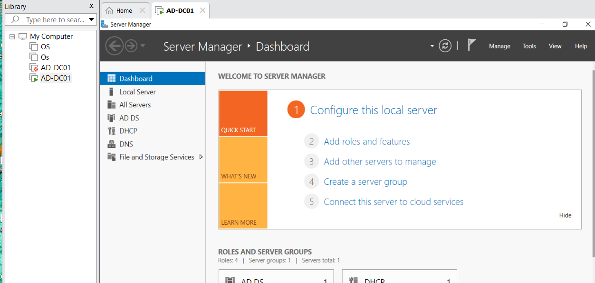

## Lab Environment

| Component        | Details                                    |
|------------------|--------------------------------------------|
| Hypervisor       | VMware Workstation                         |
| Server OS        | Windows Server 2022 (Domain Controller)    |
| Domain           | `mojlab.local`                             |
| Server IP        | 192.168.253.10 (static)                    |
| Network          | VMware NAT (VMnet8), gateway 192.168.253.2 |
| Roles installed  | AD DS, DNS Server, DHCP Server, File and Storage Services |

## What I Configured

### 1. Active Directory structure
- Created the **Zaposleni** (Employees) organizational unit
- Created user accounts and department-based security groups: **IT**, **Menadzment** (Management), **Ekonomija** (Economics)
- Assigned the *Department* attribute to users

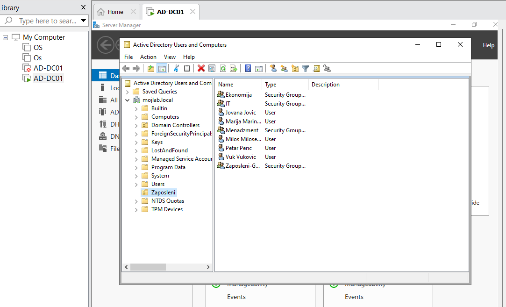
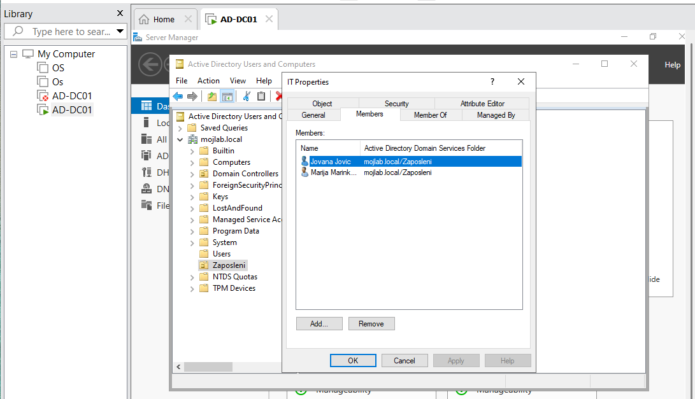

### 2. User provisioning with PowerShell
- Wrote [`Create-UsersFromCSV.ps1`](scripts/Create-UsersFromCSV.ps1), which imports users from [`users.csv`](scripts/users.csv)
- The script creates the OU if missing, skips existing users, creates a security group per department and adds each user to it
- New accounts must change their password at first logon; the initial password is entered at runtime, not stored in the script

```powershell
.\Create-UsersFromCSV.ps1 -CsvPath "C:\Scripts\users.csv" -OUName "Zaposleni"
```

### 3. Group Policy
- **Politika-Zaposleni** – desktop wallpaper policy for domain users
- **Restrikcije-Zaposleni** (linked to the Zaposleni OU):
  - Computer Configuration: *All Removable Storage classes: Deny all access* (blocks USB storage)
  - User Configuration: *Prohibit access to Control Panel and PC settings*

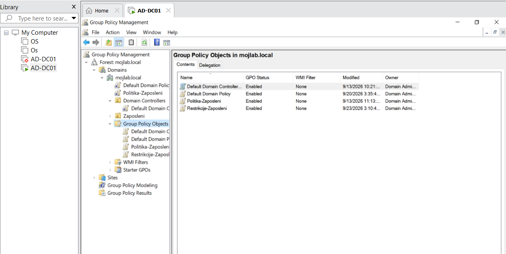
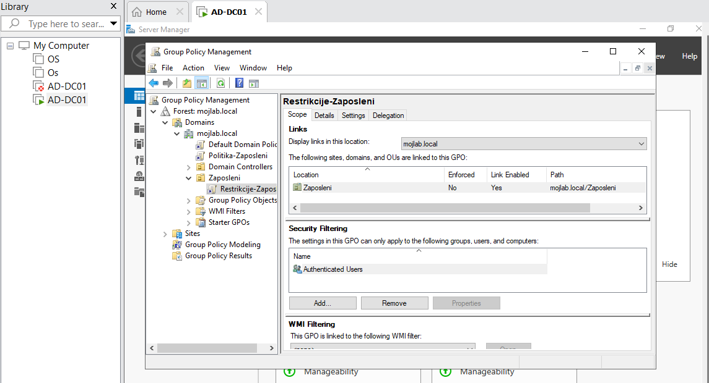
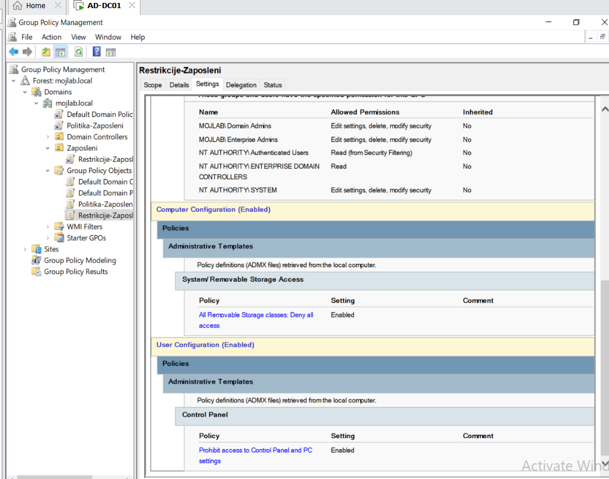

### 4. File sharing and permissions
- Created the shared folder **C:\IT-Dokuments**
- Share permissions: *Change* + *Read* for the **IT** group
- NTFS permissions: *Modify* for the **IT** group

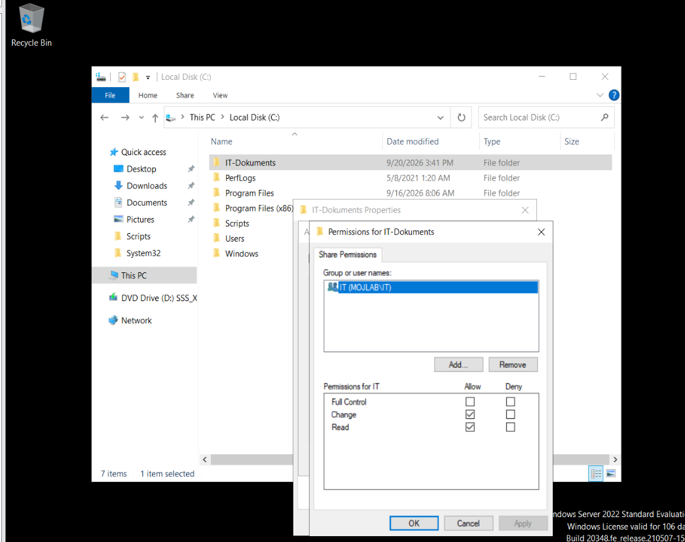
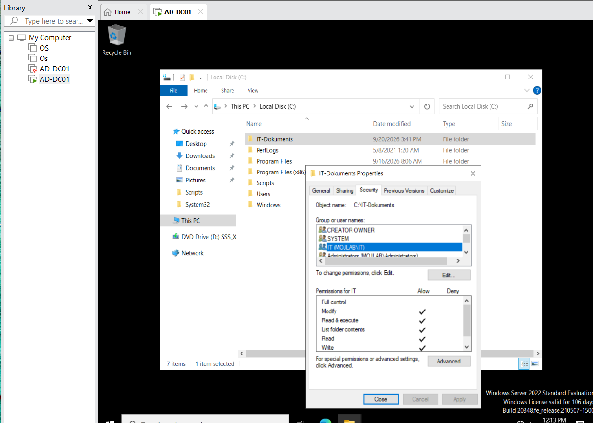

### 5. Fine-Grained Password Policy
Created the PSO **IT-Stroza-Politika** in Active Directory Administrative Center and applied it to the **IT** group (precedence 10):

| Setting                         | Value      |
|---------------------------------|------------|
| Minimum password length         | 12         |
| Password history                | 5          |
| Complexity requirements         | Enabled    |
| Minimum / maximum password age  | 1 / 42 days|
| Account lockout threshold       | 3 attempts |
| Lockout duration / reset counter| 30 min     |

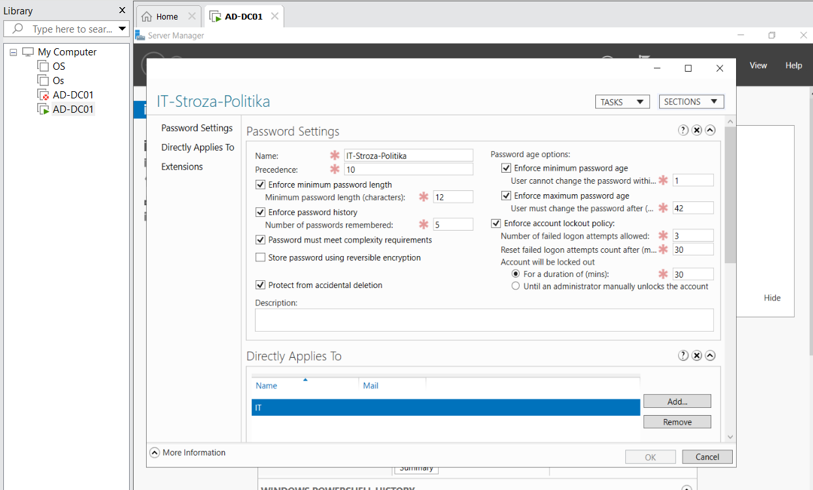

### 6. Auditing and log analysis
- Enabled **Audit Policy** for Logon/Logoff events through the Default Domain Policy
- Verified events in **Event Viewer** → Security log: Event ID **4624** (successful logon) and **4634** (logoff)

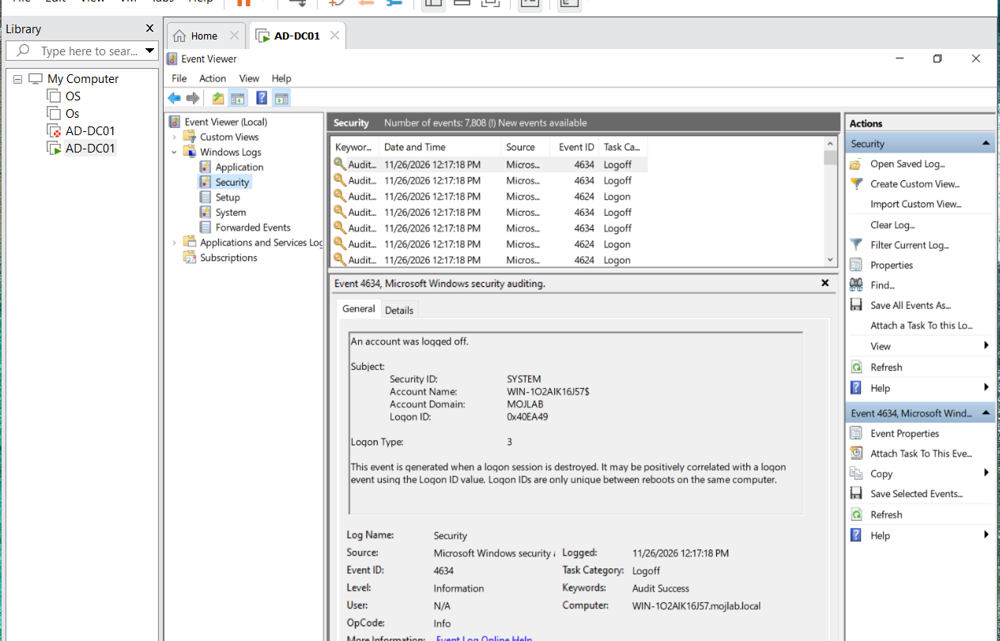

### 7. DHCP
- Disabled VMware's built-in DHCP on VMnet8 and installed the DHCP Server role
- Created and activated the scope **Mojlab-Scope** (192.168.253.0):
  - Address pool: 192.168.253.100 – 192.168.253.200
  - Router (gateway): 192.168.253.2
  - DNS server: 192.168.253.10

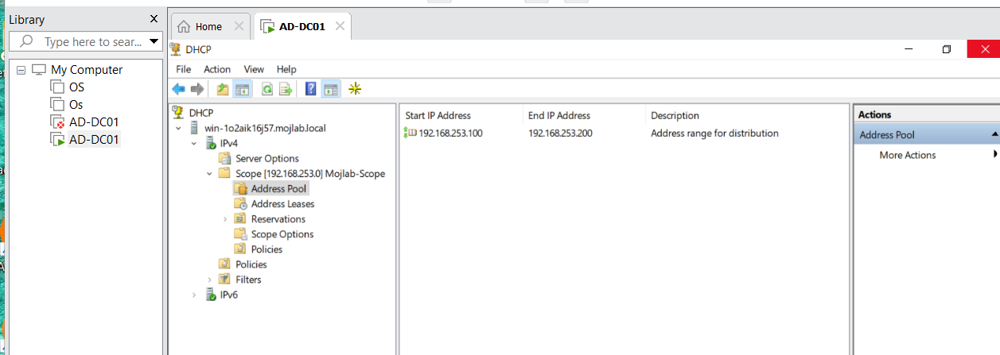

### 8. DNS
- Added an **A record** `webserver` → 192.168.253.50
- Added a **CNAME** `intranet` → `webserver.mojlab.local`
- Verified name resolution with `nslookup`

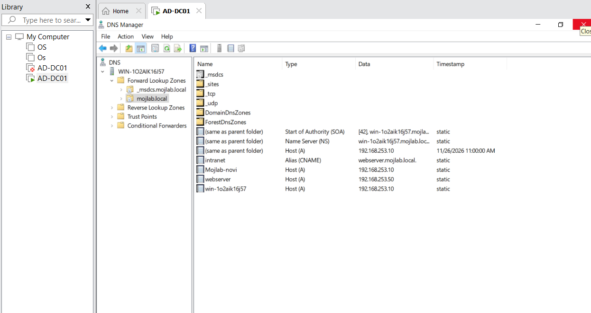
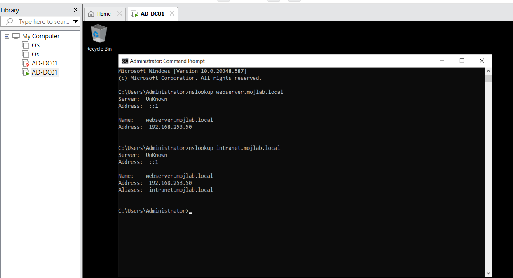

### 9. Kerberos Constrained Delegation
- Registered an SPN (`HTTP/webapp.mojlab.local`) with `setspn` on a service account
- Configured constrained delegation (*Kerberos only*) from that account to the **CIFS** service on the domain controller

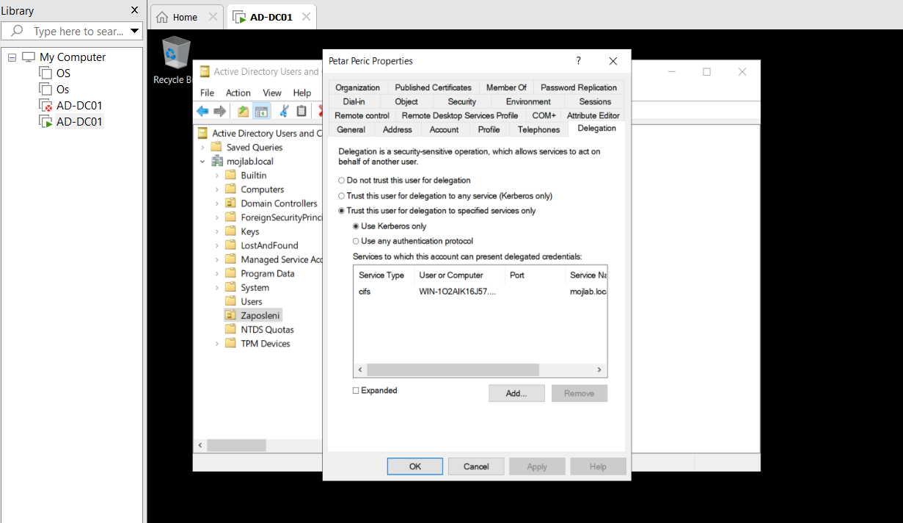

## Skills Practiced

Active Directory · Group Policy · PowerShell · NTFS & Share Permissions · Fine-Grained Password Policies · Audit Policy & Event Viewer · Kerberos · DHCP · DNS · Windows Server 2022 · VMware

## Next Steps

- Join a Windows client machine to the domain and test GPOs, DHCP leases and logons from the client side
